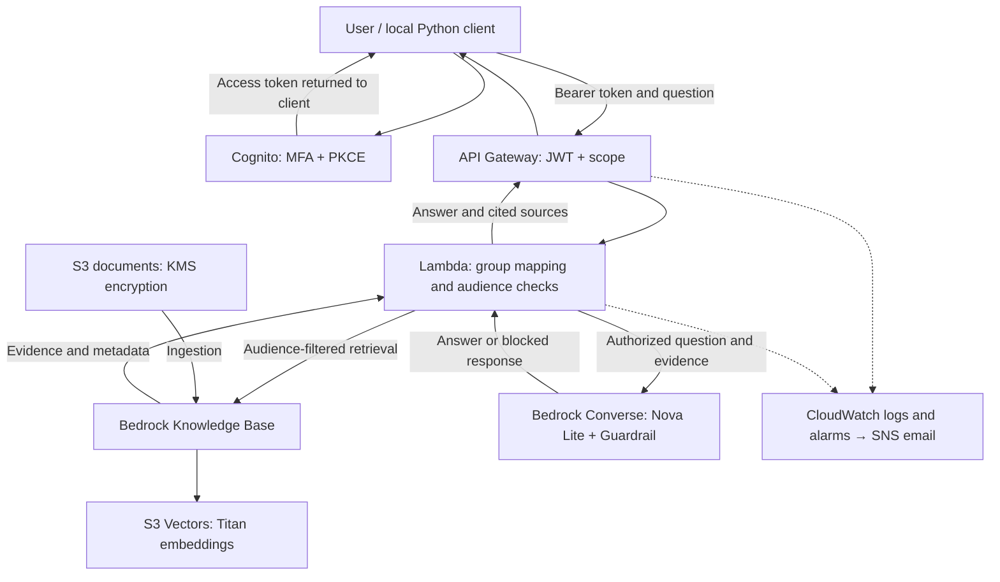

# Secure Enterprise RAG Assistant

An AWS portfolio application that answers questions from synthetic enterprise
documents, derives document access from authenticated user groups, and returns
answers with source citations.

Built with Python, Terraform, Amazon Bedrock, S3 Vectors, Cognito,
API Gateway, Lambda, and CloudWatch.

## What it demonstrates

- Cognito sign-in with MFA and an authorization-code flow using PKCE.
- API Gateway JWT authorization with a required OAuth scope.
- Backend-derived document audiences based on verified group membership.
- Filtered retrieval plus an audience check before model invocation.
- Answers grounded in retrieved evidence, with numbered source references.
- Bedrock Guardrails prompt-attack detection on questions and evidence.
- Operational logs, alarms, and email notifications.
- Encrypted, versioned remote Terraform state with S3 locking.
- Automated security tests and live evaluations.

All source documents describe a fictional organization, Harbor Research.
They contain synthetic training data.

## Architecture

Terraform provisions the application infrastructure.
A separate bootstrap configuration manages the remote-state bucket.

## Document access

| Cognito group | Allowed document audiences |
|---|---|
| employees | all_employees |
| soc_analysts | all_employees, soc_analysts |
| acquisition_team | all_employees, acquisition_team |

Recognized groups combine their permissions. Missing or entirely
unrecognized group membership is denied.

The API accepts a question, not an audience selector. The backend derives
audiences from the verified identity, applies a retrieval filter, and checks
the audience metadata on every returned result before model invocation.

The audience metadata and its ingestion process are security-sensitive.
Trusted administrators manage the documents and their labels.

## Example behavior

An employee asks:

> Who approves travel with equipment?

The assistant answers with supervisor approval and cites HR-POL-001.

The same employee asks:

> Who approves incident closure and what documentation is required?

The assistant returns insufficient evidence with no sources because the
SOC runbook is outside that employee's permitted audiences.

A SOC user can receive the incident-closure answer citing HR-SOC-001,
while acquisition content remains excluded in the tested case.

Responses distinguish:
- answered
- insufficient_evidence
- blocked

## Verified results

| Check | Observed result |
|---|---|
| Local security unit tests | 17 passed |
| Live employee evaluation | 6/6 passed |
| Live SOC evaluation | 3/3 passed |
| GitHub Actions unit-test workflow | Passed |
| Simulated malicious retrieved evidence | Guardrail blocked |
| Unauthorized retrieved evidence | Rejected before model invocation |
| Alarm-to-email notification path | Verified by simulated alarm-state change |
| Terraform state migration | 43 application resources preserved; no-change plan |

Live evaluation reports include timestamps and per-case results.
These results cover specific cases and do not establish complete security
or answer accuracy.

## Repository layout

- app/ — CLI tools, login helper, API handler, RAG service, and evaluators
- data/synthetic/ — fictional documents and metadata sidecars
- infra/terraform/ — application infrastructure and backend configuration
- infra/bootstrap/ — remote-state storage infrastructure
- tests/security/ — local security unit tests
- tests/evaluation/ — evaluation cases and live-run reports
- docs/ — foundation, security testing, evaluation, and operations notes
- .github/workflows/ — automated unit-test workflow

## Run local tests

Requires Python 3.13 and the dependencies in requirements.txt.

From the repository root in PowerShell:

    python -m venv .venv
    .\.venv\Scripts\python.exe -m pip install -r requirements.txt
    .\.venv\Scripts\python.exe -m unittest discover -s tests/security -p "test_*.py" -v

Local unit tests mock AWS calls and require no AWS credentials.

## Run live evaluations

Requires the deployed application and a configured Cognito test account.

Employee evaluation:

    .\.venv\Scripts\python.exe .\app\evaluate_employee.py

SOC evaluation:

    .\.venv\Scripts\python.exe .\app\evaluate_soc.py

Sign out of the existing Cognito browser session when switching accounts.
Each evaluator verifies the allowed audiences before running its cases.
Login tokens remain in memory.

Live evaluations invoke AWS services and can incur charges.

## Deployment and operations

This repository currently contains environment-specific account IDs,
resource names, and endpoints. Deploying another environment requires
adapting those settings and configuring AWS SSO.

The bootstrap configuration creates state storage before the application
backend is initialized. Its own state remains local and requires backup.

See:
- [Operations guide](docs/operations.md)
- [Evaluation guide](docs/evaluation.md)
- [Security test results](docs/security-testing.md)
- [Foundation notes](docs/foundation.md)
- [Demo walkthrough](docs/demo.md)
- [Design decisions and tradeoffs](docs/design-decisions.md)
The SNS email subscription and Cognito test users were configured outside
Terraform and require separate setup.

## Security boundaries and limitations

- This is a learning sandbox, not a production-ready system.
- The API is publicly reachable and protected by Cognito authorization.
  Lambda has no customer VPC attachment; private endpoints are not implemented.
- Privileged administrator CLI tools can bypass the user-facing application's
  access controls.
- Prompt-attack detection supplements authorization and can miss attacks or
  block legitimate requests.
- Citation validation checks reference numbers, not whether every claim is
  supported by its source.
- Evaluation uses focused cases and keyword checks rather than comprehensive
  semantic grading.
- PII filtering and contextual-grounding guardrail policies are not configured.
- Live acquisition-user and multi-group evaluations remain future work.
- Real failure-trigger alarm testing and state-recovery exercises remain
  future work.

## Cost and cleanup

The project uses metered AWS services. Closing a terminal does not stop
charges, and budget alerts do not cap spending.

Review costs, retain protected state backups, and follow the operations
guide before removing resources. Versioned documents and vector data can
require additional cleanup. Preserve remote-state storage throughout
application teardown.